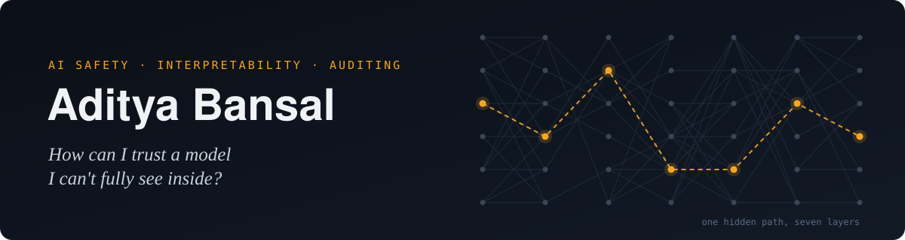
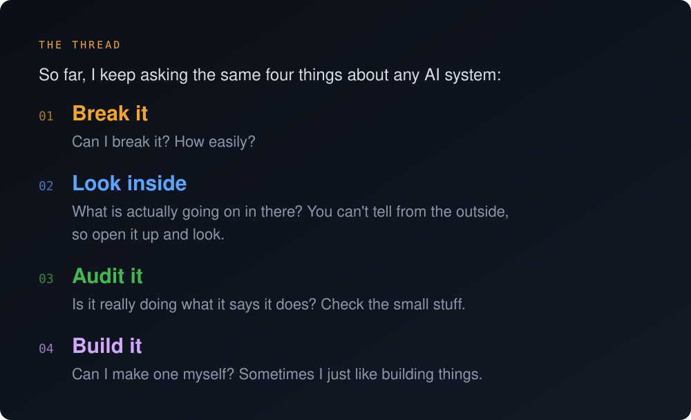

  
  
  

<b>Toolkit</b>

  
  
  
  
  
  
  
  
   
  
  
  
  
  

Before safety, as a founding engineer at an earlier startup (2024), I trained RL policies for satellite collision avoidance. It was my first time working on a system where an unexplained decision is not acceptable.

